domb-napari
===========

[](https://stand-with-ukraine.pp.ua)

[](https://napari-hub.org/plugins/domb-napari)


[](https://doi.org/10.5281/zenodo.14843770)

__napari Toolkit of Department of Molecular Biophysics <br /> Bogomoletz Institute of Physiology of NAS of Ukraine, Kyiv,  Ukraine__

Widgets for analysis of redistribution and interaction (3-cube E-FRET) of fluorescence-labeled proteins in widefield time-lapse acquisitions.


__Hippocalcin (neuronal calcium sensor) redistributes in dendritic branches upon NMDA application__

## Installation
```
pip install domb-napari
```
Requires Python >= 3.10 and napari >= 0.5. Changes between versions are listed in [CHANGELOG.md](CHANGELOG.md).

## Data Conventions

| Item | Convention |
|---|---|
| Input stack | 4D `TCXY` or `CTXY`, or 3D `TXY`; any numeric type |
| Dual-view stack | emission sides alternate along the channel axis (see below) |
| Processed images | `float32`, signed, never clipped; pixels without data or with undefined value are `NaN` |
| Labels | 2D, `0` is background; ROI number in outputs is the label value |

Channels of a 4-channel dual-view FRET stack (2 excitations x 2 emission sides):

| Channel | Excitation | Emission | Notation |
|---|---|---|---|
| `ch0` | donor | donor | $I_{DD}$ |
| `ch1` | donor | acceptor | $I_{DA}$ |
| `ch2` | acceptor | donor | not used |
| `ch3` | acceptor | acceptor | $I_{AA}$ |

Suffixes of output layers:

| Widget | Suffix |
|---|---|
| Dual-view stack registration | `_algn` |
| Multichannel stack preprocessing | `_ch{i}`, optional `_{start}-{stop}` and `_{correction method}` |
| E-FRET estimation | `_Fc`, `_E_D`, `_E_A`, `_Ecorr`, optional `_norm` (`_ch3` of the AA layer name is dropped) |
| Red-green series | `_red-green`, `_red-green-MIP` |
| ΔF series | `_ΔF`, `_ΔF/F0` |
| Dot-patterns masking | `_dots-labels` |
| Up masking | `_up-labels`, `_up-mask` |
| Intensity masking | `_up-labels`, `_down-labels` |

## Workflow
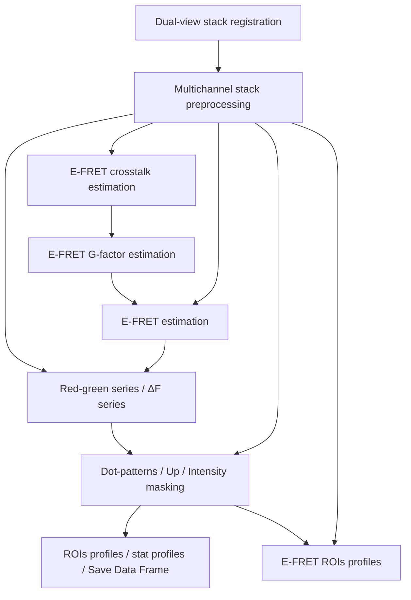

Widgets are placed in the napari `Layers` menu:

| Menu | Widgets |
|---|---|
| Data > Preprocessing | Multichannel stack preprocessing, Dual-view stack registration |
| Data | Save Data Frame |
| Measure | Red-green series, ΔF series |
| Measure > FRET | E-FRET estimation, E-FRET ROIs profiles, E-FRET G-factor estimation, E-FRET crosstalk estimation |
| Segment | Dot-patterns masking, Up masking, Intensity masking |
| Visualize > Labels Profiles | ROIs profiles, Multiple img stat profiles, Multiple labels stat profiles |

---

## Preprocessing
### Dual-view Stack Registration
Affine registration of the emission sides of a dual-view splitter by mutual information. The transform is estimated with time-averaged images and applied to every frame with linear interpolation.

| Parameter | Default | Description |
|---|---|---|
| `offset_img` | | 4D stack with 2 or 4 channels |
| `input_crop` | 30 | px removed from each side before registration |
| `output_crop` | 30 | px removed from each side after registration |
| `align_method` | `internal` | `internal` - estimate the transform; `load matrix` - apply a saved one |
| `manual_channels` | off | use `ref_off_ch` instead of the default pair |
| `ref_off_ch` | `[0, 1]` | reference and offset channel indexes |
| `load_matrix` | | `.txt` file with a 3x3 matrix |
| `save_matrix`, `saving_path` | off | save the estimated matrix as `{name}_affine_matrix.txt` |

- Default pair: offset `ch0`, reference - the last channel. All channels with the same index parity as the offset one are transformed.
- A matrix is valid only for the `input_crop` it was estimated with (written to the file header).
- The result is rejected (stack is not transformed, warning is shown) if it does not increase mutual information.

Output: 4D stack `_algn`.

### Multichannel Stack Preprocessing
| Parameter | Default | Description |
|---|---|---|
| `img` | | 4D or 3D stack |
| `stack_order` | `TCXY` | axes order of a 4D stack, `TCXY` or `CTXY` |
| `median_filter`, `median_kernel` | off, 3 | frame-by-frame median filter, kernel size in px |
| `background_substraction`, `background_percentile` | on, 1.0 | subtract the percentile of intensity of every frame |
| `photobleaching_correction` | off | divide frames by the bleaching curve of the masked area |
| `correction_mask` | | Labels layer for the bleaching curve, Otsu mask of the 1st frame if empty |
| `correction_method` | `exp` | `exp`: $a e^{-bt}+c$; `biexp`: $a e^{-bt}+c e^{-dt}+e$; `1st`: raw curve |
| `drop_frames`, `frames_range` | off, `[0, 10]` | keep frames `start:stop` |
| `frames_crop` | 0 | px removed from each side |

Order of operations: frames drop, median filter, background, photobleaching, crop.

> [!WARNING]
> Photobleaching-corrected stacks are not valid inputs for E-FRET: every channel is rescaled with its own curve.

Output: one 3D stack per channel, `_ch{i}`.

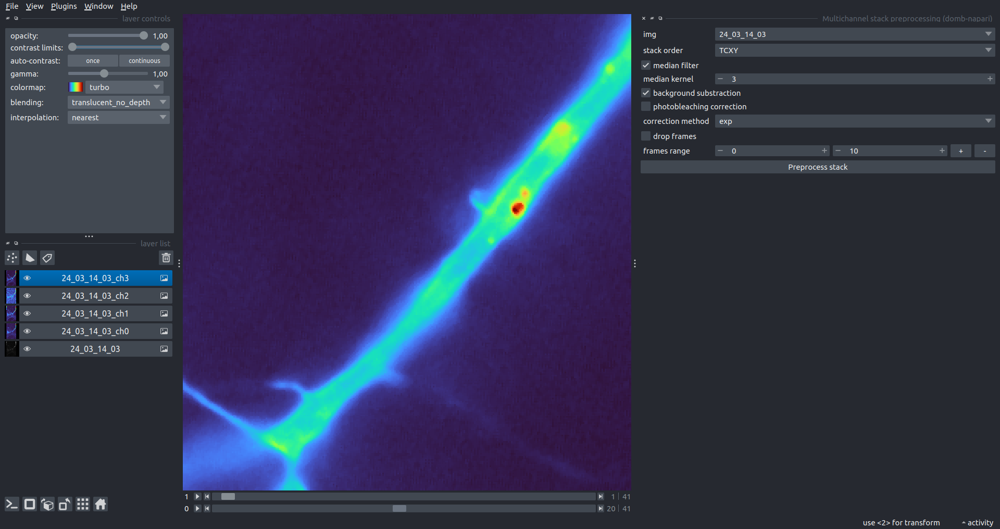

---

## Detection of Fluorescence Redistribution
Based on [Dovgan et al., 2010](https://pubmed.ncbi.nlm.nih.gov/20704590/) and [Osypenko et al., 2019](https://www.sciencedirect.com/science/article/pii/S0969996119301974?via%3Dihub).

### Red-Green Series
```math
R_i = \frac{1}{r}\sum_{t=i+l+s}^{i+l+s+r-1} F_t - \frac{1}{l}\sum_{t=i}^{i+l-1} F_t
```

| Parameter | Default | Description |
|---|---|---|
| `img` | | 3D stack |
| `left_frames` | 1 | $l$, frames of the baseline window |
| `space_frames` | 0 | $s$, skipped frames between the windows |
| `right_frames` | 1 | $r$, frames of the response window |
| `normalize_by_int` | off | multiply by the mean intensity of both windows / stack maximum; for visualization and masking only |
| `save_MIP` | off | save maximal intensity projection of the series |

Output: `_red-green` with $T-(l+s+r)+1$ frames; frame $i$ is the transition between input frames $i+l-1$ and $i+l+s$.

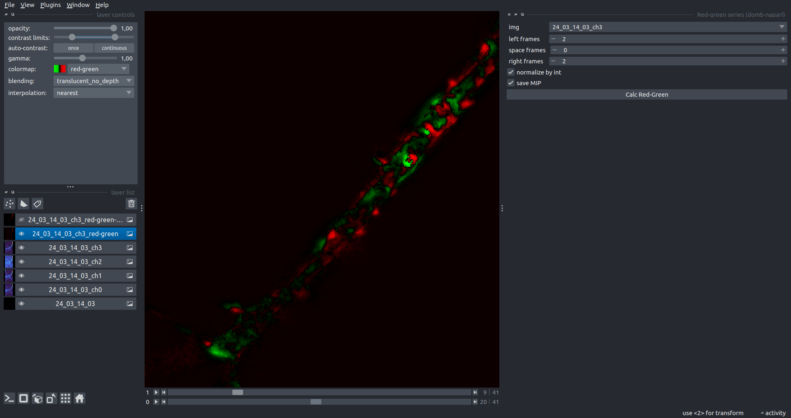

### ΔF Series
| Parameter | Default | Description |
|---|---|---|
| `img` | | 3D stack |
| `values_mode` | `ΔF` | `ΔF`: $F_t - F_0$; `ΔF/F0`: $(F_t - F_0)/F_0$ |
| `F0_win` | 5 | number of the first frames averaged to $F_0$ |
| `F0_min` | 0 | `ΔF/F0` only: pixels with $F_0 \le$ `F0_min` are `NaN` |
| `intensity_weighted` | off | multiply by the normalized maximal intensity projection; for visualization and masking only |

Output: `_ΔF` or `_ΔF/F0`.

---

## Masking
### Dot-patterns Masking
Steps: MIP of the stack, background removal, local maxima, disk around every maximum, watershed split of merged disks.

| Parameter | Default | Description |
|---|---|---|
| `img` | | 3D stack |
| `background_level` | 75 | percentile of MIP intensity subtracted as background |
| `detection_level` | 25 | minimal intensity of a dot, % of MIP maximum |
| `minimal_distance` | 2 | minimal distance between dots, px |
| `mask_radius` | 5 | radius of the mask of a dot, px |

Output: `_dots-labels`.

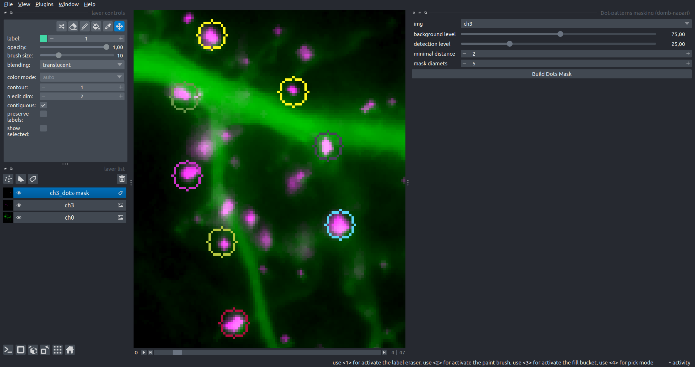
__Hippocalcin (green) and PSD95 (magenta) in dendritic branches__

### Up Masking
| Parameter | Default | Description |
|---|---|---|
| `img` | | 3D stack (raw or `_red-green`) |
| `ROIs_mask` | | Labels layer for in-ROIs detection |
| `det_frame_index` | 2 | frame used for detection |
| `det_th` | 0.25 | global mode: threshold = max\|frame\| x `det_th` x 0.1 |
| `in_ROIs_det` | off | detect separately inside of every ROI of `ROIs_mask` |
| `in_ROIs_det_method` | `otsu` | `otsu` or `threshold` (max\|ROI box\| x `det_th` x `in_ROIs_det_th_corr`) |
| `in_ROIs_det_th_corr` | 0.1 | threshold scale of the in-ROIs `threshold` method |
| `final_opening_fp` | 1 | radius of morphological opening, 0 - off |
| `final_dilation_fp` | 0 | radius of morphological dilation, 0 - off |
| `save_total_up_mask` | off | save the binary mask `_up-mask` |

- Threshold detection is followed by erosion (disk 2), dilation (disk 1) and holes filling.
- In-ROIs mode: detected sites are restricted to the pixels of their ROI and keep its label.

Output: `_up-labels`.

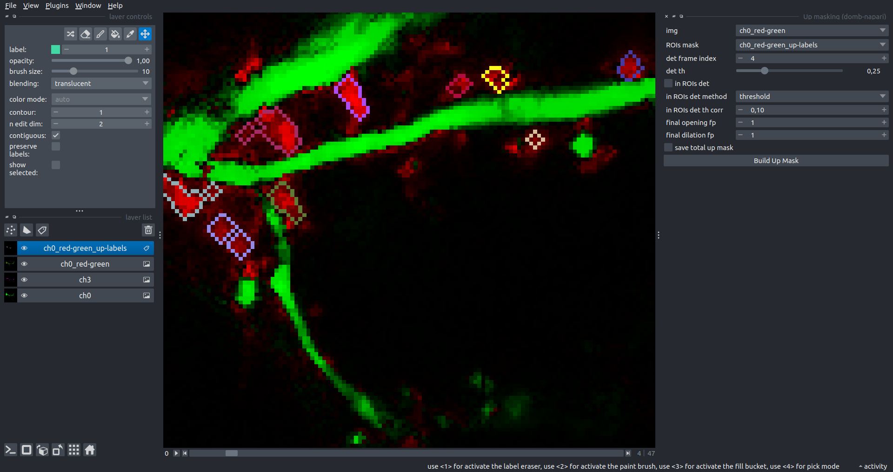
__Global up labels__

In-ROIs masking (reference)|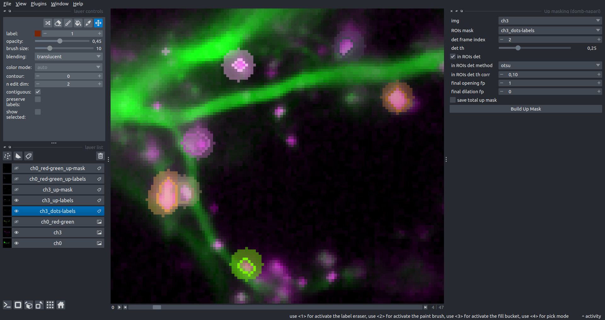
:------------------:|:-------------------------:
__In-ROIs masking (translocation)__|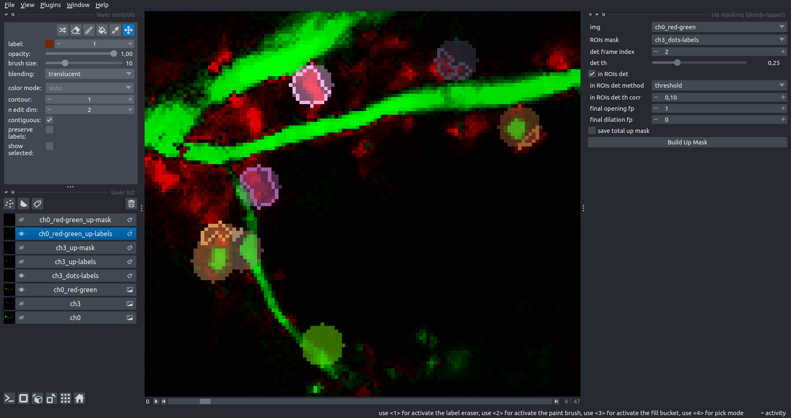
__Masks overlay__|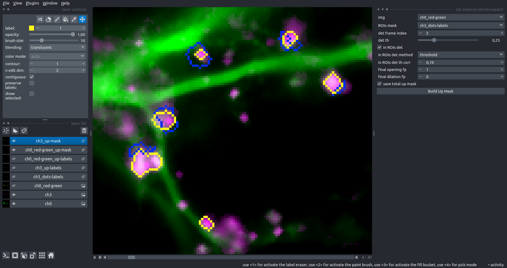

### Intensity Masking
| Parameter | Default | Description |
|---|---|---|
| `img` | | 3D stack, usually `_red-green` |
| `det_frame_index` | 2 | frame used for detection |
| `masking_mode` | `up` | `up` - intensity gain, `down` - intensity loss |
| `up_threshold` | 0.2 | `up`: frame >= max\|frame\| x `up_threshold` |
| `down_threshold` | -0.9 | `down`: frame <= max\|frame\| x `down_threshold` |
| `opening_footprint` | 0 | radius of morphological opening, 0 - off |

Output: `_up-labels` or `_down-labels`.

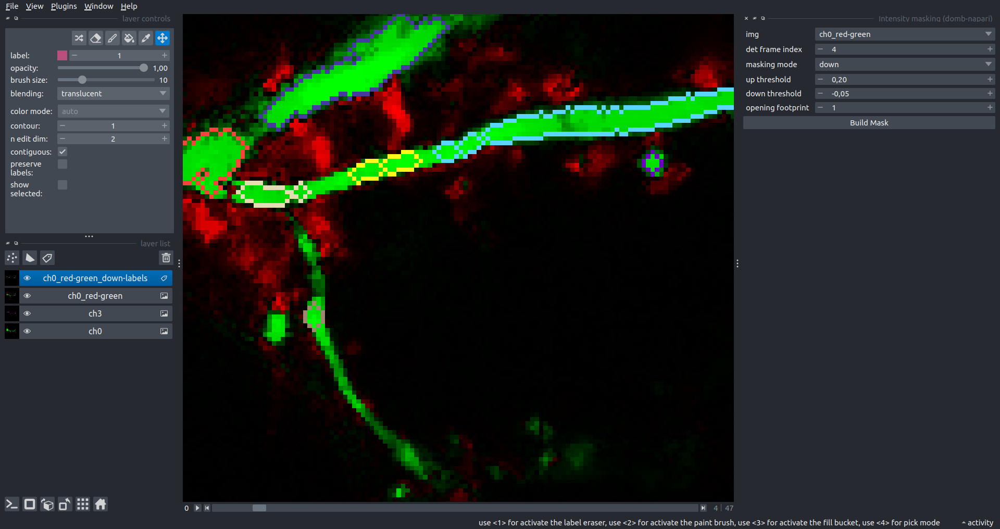

---

## 3-cube E-FRET
Notation follows [Zal and Gascoigne, 2004](https://pubmed.ncbi.nlm.nih.gov/15189889/), [Chen et al., 2006](https://pubmed.ncbi.nlm.nih.gov/16815904/) and [Erickson et al., 2001](https://doi.org/10.1016/s0896-6273(01)00438-x).

| Symbol | Definition |
|---|---|
| $I_{DD}, I_{DA}, I_{AA}$ | background subtracted intensities, see Data Conventions |
| $a = I_{DA(A)}/I_{AA(A)}$, $b = I_{DD(A)}/I_{AA(A)}$ | cross-talk of acceptor-only sample |
| $d = I_{DA(D)}/I_{DD(D)}$, $c = I_{AA(D)}/I_{DD(D)}$ | cross-talk of donor-only sample |
| $G$ | gauge factor: sensitized emission per unit of quenched donor emission |
| $\xi$ | ratio of acceptor to donor extinction coefficients at donor excitation |

```math
D = \frac{I_{DD} - b I_{AA}}{1 - bc} \qquad A = \frac{I_{AA} - c I_{DD}}{1 - bc} \qquad F_c = I_{DA} - aA - dD
```
```math
E_D = \frac{F_c}{F_c + G D} \qquad E_A = \xi\frac{F_c}{aA} \qquad E_{corr}(t) = E_D(t)\frac{\langle A(0)\rangle}{\langle A(t)\rangle}
```

- $b = c = 0$ gives the conventional $F_c = I_{DA} - aI_{AA} - dI_{DD}$.
- $\langle A \rangle$ is the mean over the bleaching mask.
- Values are signed and not clipped; pixels with a non-positive denominator are `NaN`.
- Efficiency of a ROI has to be calculated from mean intensities of the ROI (E-FRET ROIs profiles), the mean of pixel-wise efficiencies is biased at low signal.

Calibration:

| Step | Sample | Widget | Result |
|---|---|---|---|
| 1 | acceptor only | E-FRET crosstalk estimation, `A` | $a$, $b$ |
| 2 | donor only | E-FRET crosstalk estimation, `D` | $d$, $c$ |
| 3a | donor-acceptor tandem, before and after acceptor photobleaching | E-FRET G-factor estimation, `Zal` | $G$ |
| 3b | two tandems (1:1) with different efficiency | E-FRET G-factor estimation, `Chen` | $G$ |
| 4 | | YAML configuration | coefficients of the FRET pair |

### E-FRET Crosstalk Estimation
Slope of the cross-talk channel against the reference channel over the pixels of the mask.

| Parameter | Default | Description |
|---|---|---|
| `DD_img`, `DA_img`, `AA_img` | | 3D stacks |
| `mask` | | Labels layer, non-zero pixels are used |
| `presented_fluorophore` | `A` | `A` - acceptor only ($a$, $b$), `D` - donor only ($d$, $c$) |
| `saving_path` | home | output directory |

Estimators (columns for coefficient `x`):

| Columns | Estimator | Property |
|---|---|---|
| `x_val`, `x_err`, `x_i`, `x_i_err` | Deming regression, slope and intercept | primary; consistent with noise in both channels and with a residual offset |
| `x_ratio`, `x_ratio_err` | ratio of sums | consistent with noise in both channels, biased by an offset |
| `x_ols`, `x_ols_err`, `x_ols_i`, `x_ols_i_err`, `x_r^2`, `x_p` | OLS | underestimates the slope if the reference channel is noisy; diagnostics |

- Deming noise variance ratio is `mean(y)/mean(x)` (shot noise, same detector gain).
- Errors are jackknife standard errors, lower bounds for spatially correlated pixels.
- An intercept far from zero indicates inaccurate background subtraction.

Output: `{name}_{A|D}.csv` (every frame), `{name}_{A|D}_summary.csv` (time-averaged images: final values, plus `x_frames_median`, `x_frames_mad`), plot of the time-averaged data.

### E-FRET G-factor Estimation
```math
G_{Zal} = \frac{F_c - F_c^{post}}{D^{post} - D} \qquad G_{Chen} = \frac{F_{c,1}/A_1 - F_{c,2}/A_2}{D_2/A_2 - D_1/A_1}
```

| Parameter | Default | Description |
|---|---|---|
| `estimation_method` | `Zal` | `Zal` - acceptor photobleaching; `Chen` - two constructs |
| `DD_img_high_FRET`, `DA_img_high_FRET`, `AA_img_high_FRET` | | 3D stacks: before bleaching / high FRET construct |
| `DD_img_low_FRET`, `DA_img_low_FRET`, `AA_img_low_FRET` | | 3D stacks: after bleaching / low FRET construct |
| `mask` | | `Zal`: Labels layer of ROIs or of the whole area |
| `segment_mask`, `fragments_num` | on, 30 | `Zal`: split the mask into compact fragments of similar area (k-means) |
| `mask_high`, `mask_low` | | `Chen`: Labels layers of ROIs for both samples |
| `frames_to_average` | 1 | number of the first frames averaged, 0 - all |
| `a`, `d`, `b`, `c` | | cross-talk coefficients |
| `write_to_config`, `config_path`, `fret_pair` | off | write `a`, `d`, `b`, `c`, `G` to a YAML file |
| `saving_path` | home | output directory |

- `Zal`: `g_val` is the area-weighted ratio of sums over ROIs, `g_err` - jackknife error. `g_deming`, `g_ols`, `g_i` (OLS intercept), `g_r^2` are diagnostics: an intercept far from zero indicates wrong cross-talk coefficients, misregistration or donor bleaching.
- `Chen`: every term is a ratio of sums over ROIs; `g_err`, `g_ci_low`, `g_ci_high` are bootstrap error and 95% interval.
- ROIs of one cell are not independent: errors describe the within-sample variability only.

Output: `{name}_G.csv`, plot, `_seg_labels` (if `segment_mask`).

### E-FRET Estimation
Pixel-wise estimation.

| Parameter | Default | Description |
|---|---|---|
| `config_mode` | `Default` | `Default` - bundled configuration; `Load` - file from `config_path` |
| `config_path` | | YAML configuration file |
| `fret_pair` | | FRET pair from the configuration |
| `output_type` | `Fc` | `Fc`, `E_D`, `E_A` or `Ecorr` |
| `DD_img`, `DA_img`, `AA_img` | | 3D stacks |
| `bleach_mask` | | `Ecorr`: Labels layer for the acceptor bleaching curve, whole frame if empty |
| `save_normalized` | on | additional image weighted by the mean $I_{AA}$ (0-1), suffix `_norm` |

> [!WARNING]
> `_norm` images are intended for visual inspection and mask construction only.

Raw Eapp| 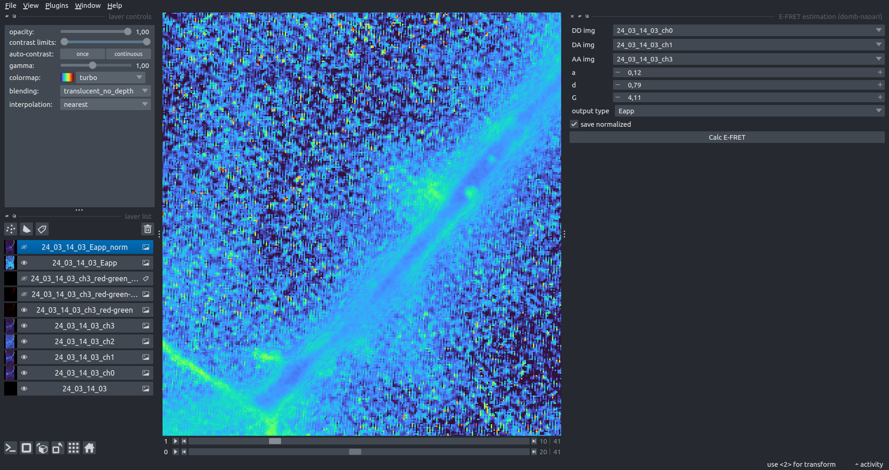
:-:|:-:
__Normalized Eapp__|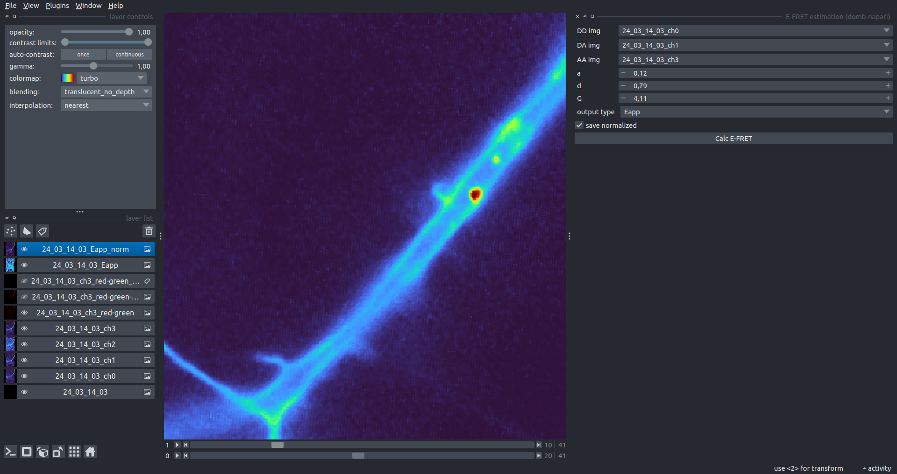

### E-FRET ROIs Profiles
ROI-wise estimation from mean intensities of ROIs (ratio of means).

| Parameter | Default | Description |
|---|---|---|
| `config_mode`, `config_path`, `fret_pair` | | as in E-FRET estimation |
| `output_type` | `E_D` | plotted value: `Fc`, `E_D`, `E_A` or `Ecorr` |
| `DD_img`, `DA_img`, `AA_img` | | 3D stacks |
| `labels` | | Labels layer with ROIs; also the bleaching mask of `Ecorr` |
| `time_scale` | 1.0 | seconds per frame |
| `save_data_frame`, `saving_path` | off | save `{name}_{labels}_FRET.csv` |

CSV columns: `id`, `lab_id`, `roi`, `index`, `time`, `DD`, `DA`, `AA`, `D`, `A`, `Fc`, and `E_D`, `Ecorr`, `E_A` if the coefficients are defined.

### FRET Coefficients Configuration
```yaml
FRET_Pair_Name:
  a: 0.031      # required
  d: 0.415      # required
  b: 0.0        # optional, 0 by default
  c: 0.0        # optional, 0 by default
  G: 9.26       # required for E_D and Ecorr, null if not defined
  xi: 0.0535    # required for E_A, null if not defined
```
Bundled file: `domb_napari/_e_fret_coefs.yaml`.

### Python API
`domb_napari.core` does not import napari and can be used in scripts.

| Object (`domb_napari.core.fret`) | Purpose |
|---|---|
| `FRETCoefs(a, d, G, xi, b, c)`, `FRETCoefs.from_yaml(path, pair)` | coefficients container |
| `CubesFRET(dd, da, aa, a_val, d_val, G_val, eps_rel_val, b_val, c_val)` | `Fc_img()`, `E_D_img()`, `E_A_img()`, `Ecorr_img(mask, f0_frames)`, `roi_profiles(labels)` |
| `CrossTalkEstimation(mask, dd, da, aa)` | `estimate_a()`, `estimate_d()` |
| `GFactorEstimation(mask, l_mask, h_*, l_*, a_val, d_val, ...)` | `estimate_g_zal()`, `estimate_g_chen()` |
| `KFactorEstimation(mask, dd, da, aa, a_val, d_val, G_val)` | `estimate_k()`, donor/acceptor ratio factor (Chen et al., 2006) |
| `linear_fits(x, y, delta, w)` | Deming, ratio and OLS slopes with errors |

```python
from domb_napari.core.fret import CubesFRET, FRETCoefs

coefs = FRETCoefs.from_yaml('coefs.yaml', 'TagBFP/mBaoJin')
cubes = CubesFRET.from_coefs(dd, da, aa, coefs)
e_img = cubes.E_D_img()                 # [t,x,y], float32
e_roi = cubes.roi_profiles(labels)['E_D']   # [roi,t]
```

Other modules: `registration` (`AffineRegistration`, `apply_affine_stack`), `preprocess`, `series`, `masking`, `profiles`.

---

## Plotting and Data Frame Saving
Common parameters of the profile widgets:

| Parameter | Default | Description |
|---|---|---|
| `time_scale` | 1.0 | seconds per frame |
| `values_mode` | `ΔF` | `ΔF`, `ΔF/F0` or `abs.`; `ΔF/F0` is `NaN` if $F_0 \le 0$ |
| `use_simple_baseline` | on | on: $F_0$ = mean of the first `ΔF_win` points; off: Dietrich baseline ([pybaselines](https://pybaselines.readthedocs.io/en/latest/generated/api/pybaselines.Baseline.dietrich.html)) |
| `ΔF_win` | 4 | simple baseline: number of points; Dietrich: half window of smoothing |
| `Dietrich_std` | 1.25 | Dietrich: number of standard deviations for thresholding |

### ROIs Profiles
Mean intensity profile of every ROI. Parameters: `img`, `labels` and the common ones.

Absolute intensity         | 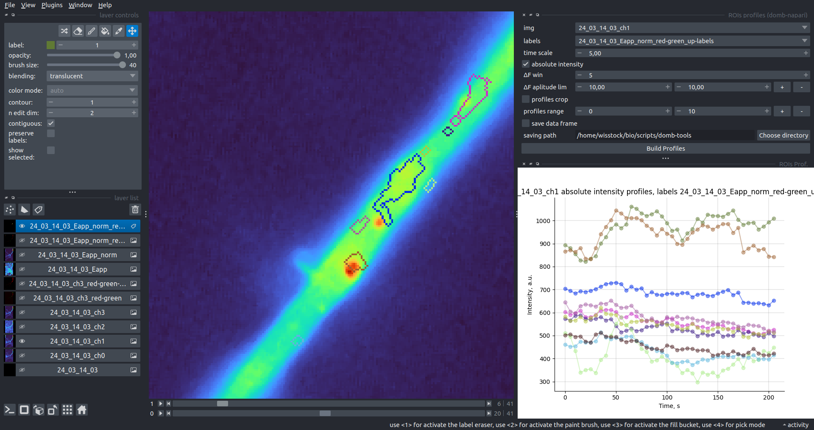
:-------------------------:|:-------------------------:
__ΔF/F0__|

### Multiple Img Stat Profiles / Multiple Labels Stat Profiles
Statistics over ROIs for up to three images with one labels layer, or one image with up to three labels layers.

| Parameter | Default | Description |
|---|---|---|
| `img_0`, `img_1`, `img_2`, `lab`, `profiles_num` | | Multiple img: images, labels, number of images used |
| `img`, `lab_0`, `lab_1`, `lab_2`, `labels_num` | | Multiple labels: image, labels layers, number of layers used |
| `stat_method` | `se` | `se`: mean ± SEM; `ci`: mean ± 95% t-interval; `iqr`: median with 1st and 3rd quartiles |

Statistics are calculated over ROIs ($n$ = number of ROIs) at every time point.

Absolute intensity         | 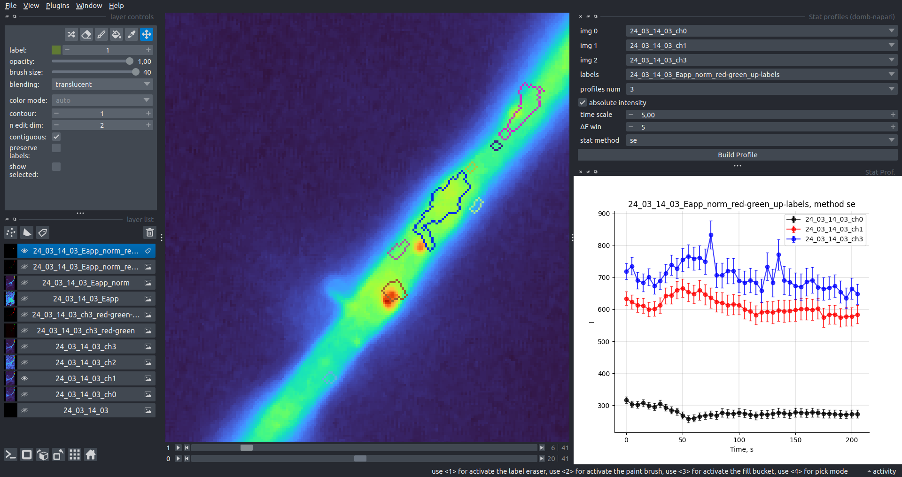
:-------------------------:|:-------------------------:
__ΔF/F0__|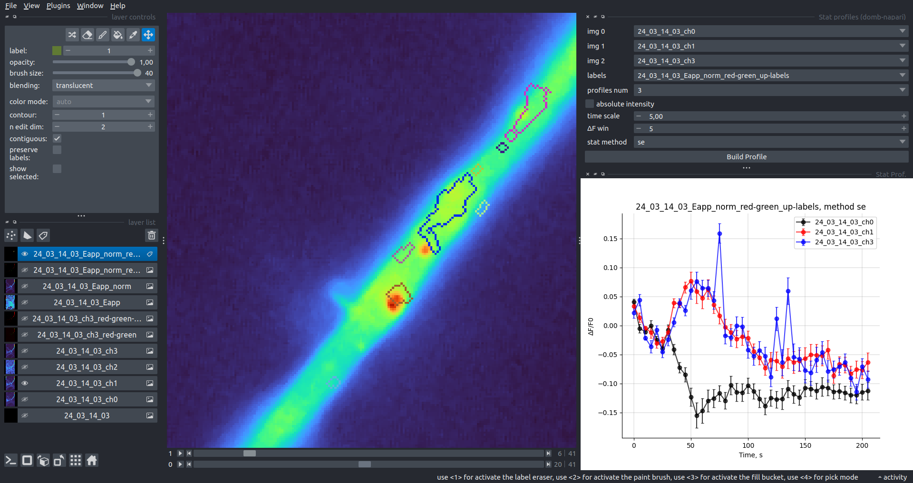

Absolute intensity         | 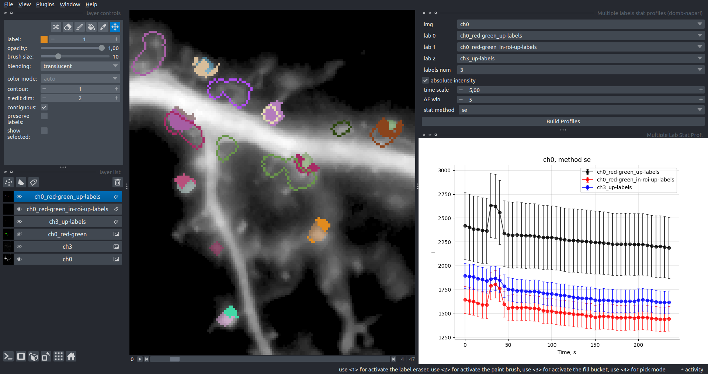
:-------------------------:|:-------------------------:
__ΔF/F0__|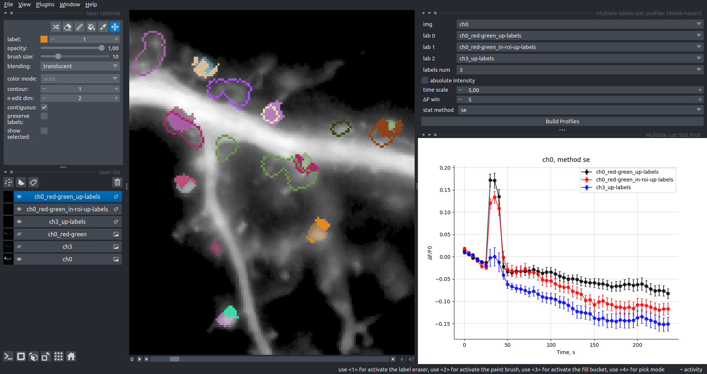

### Save Data Frame
| Parameter | Default | Description |
|---|---|---|
| `img`, `labels` | | 3D stack and Labels layer |
| `time_scale` | 1.0 | seconds per frame |
| `ΔF_win` | 4 | simple baseline window |
| `Dietrich_win`, `Dietrich_std` | 4, 1.25 | Dietrich baseline parameters |
| `save_ROIs_distances` | off | add mean distance from ROIs to the stimulation point, px |
| `custom_stim_position`, `stim_position` | off | Points layer with a single point; image center otherwise |
| `saving_path` | home | output directory |

Output: `{img}_{labels}.csv`.

| Column | Content |
|---|---|
| `id`, `lab_id` | names of the image and labels layers |
| `roi` | label value |
| `dist` | distance to the stimulation point (optional) |
| `index`, `time` | frame index and time |
| `abs_int`, `dF_int`, `dF/F0_int` | absolute, differential and relative intensity |
| `base` | baseline estimator, `simple` or `dietrich` |

---

## How to Cite
```
@article{Olifirov2025,
  title = {Local Iontophoretic Application for Pharmacological Induction of Long-Term Synaptic Depression},
  volume = {15},
  ISSN = {2331-8325},
  url = {http://dx.doi.org/10.21769/BioProtoc.5338},
  DOI = {10.21769/bioprotoc.5338},
  number = {1373},
  journal = {BIO-PROTOCOL},
  publisher = {Bio-Protocol,  LLC},
  author = {Olifirov,  Borys and Fedchenko,  Oleksandra and Dovgan,  Alexandr and Babets,  Daria and Krotov,  Volodymyr and Cherkas,  Volodymyr and Belan,  Pavel},
  year = {2025}
}
```

Software: [doi:10.5281/zenodo.14843770](https://doi.org/10.5281/zenodo.14843770).
